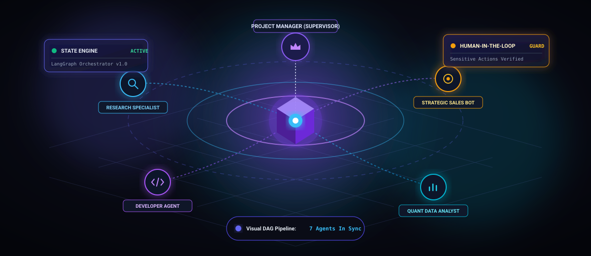
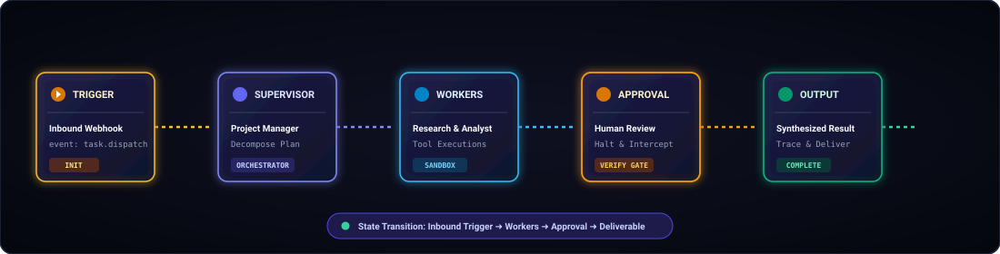
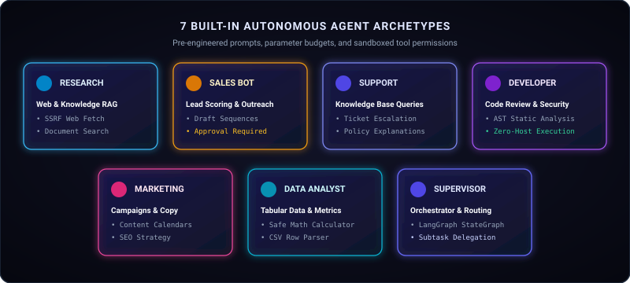
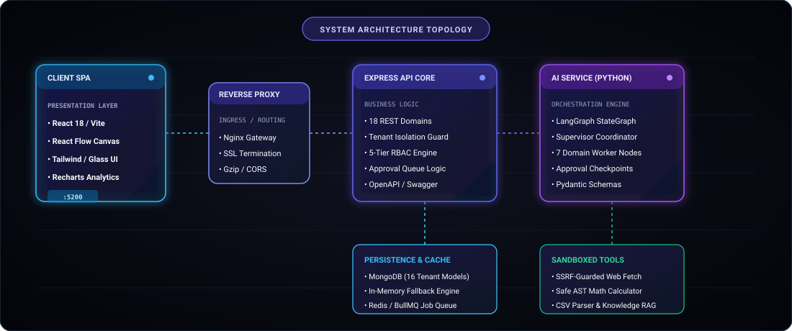

<div align="center">



# AGENTFLOW AI SAAS
### Autonomous Multi-Agent Workforce & Enterprise Orchestration Platform

[](LICENSE)
[](https://nodejs.org/)
[](https://www.typescriptlang.org/)
[](https://python.org/)
[](https://react.dev/)
[](https://docker.com)
[](#)

<p align="center">
  <b>Deploy specialized AI agent teams, build interactive visual DAG pipelines, enforce human-in-the-loop checkpoints, and monitor real-time token telemetry across multi-tenant workspaces.</b>
</p>

[Explore Documentation](docs/ARCHITECTURE.md) • [API Specification](docs/API.md) • [Quickstart Guide](docs/SETUP.md) • [Report Bug](https://github.com/danishalipny-pixel/AgentFlow-Ai-sas/issues)

</div>

---

## 01 — PRODUCT OVERVIEW

Modern organizations require intelligent automation that coordinates specialized agents rather than relying on isolated single-prompt scripts. **AGENTFLOW AI SAAS** is an enterprise AI Operations Center engineered to orchestrate autonomous agent teams safely, predictably, and with complete visibility.

```
┌────────────────────────────────────────────────────────────────────────┐
│                        CORE VALUE PROPOSITION                          │
├───────────────────┬────────────────────────────────────────────────────┤
│ The Challenge     │ Single prompts fail on complex multi-step tasks;   │
│                   │ uncontrolled agents risk unsafe actions; teams     │
│                   │ lack visual pipeline design and cost tracking.    │
├───────────────────┼────────────────────────────────────────────────────┤
│ The Solution      │ A LangGraph supervisor engine delegating to 7      │
│                   │ specialized domain agents with human approval      │
│                   │ checkpoints and an interactive React Flow canvas. │
├───────────────────┼────────────────────────────────────────────────────┤
│ Primary Users     │ SaaS Founders, Engineering Teams, AI Developers,   │
│                   │ Operations Managers, and Automation Architects.    │
└───────────────────┴────────────────────────────────────────────────────┘
```

---

## 02 — HOW AGENTFLOW WORKS

AGENTFLOW coordinates autonomous work through a stateful multi-stage lifecycle, ensuring every agent action is observable and verifiable.

<div align="center">
  
</div>

### Execution Lifecycle:
1. **Trigger Phase**: Tasks are initiated via inbound API webhooks, scheduled cron intervals, or manual user submission.
2. **Supervisor Decomposition**: The Project Manager agent decomposes the prompt into discrete ordered subtasks.
3. **Worker Delegation**: Work is dynamically assigned to specialized agents (Research, Developer, Sales, Analyst).
4. **Sandboxed Tool Execution**: Agents call approved tools (SSRF-guarded web fetcher, AST math evaluator, CSV reader).
5. **Human Approval Checkpoint**: Any sensitive or destructive action (outbound communications, database writes) automatically halts execution in state `WAITING_APPROVAL`.
6. **Synthesis & Deliverable**: Upon authorized review or plan satisfaction, the supervisor synthesizes the final verified deliverable and records the complete trace.

---

## 03 — CORE PLATFORM FEATURES

<div align="center">
  
</div>

### 1. Agent Studio & 7 Domain Archetypes
- **Research Specialist**: Scrapes public URLs with SSRF protection, searches tenant knowledge docs, and produces referenced briefs.
- **Strategic Sales Bot**: Scores inbound leads and drafts outreach sequences (gated behind human approval).
- **Customer Support Lead**: Resolves user queries using verified organization documentation.
- **Senior Developer Agent**: Performs zero-host code audits, detects vulnerabilities, and suggests refactors.
- **Growth & Content Marketer**: Creates campaign concepts and editorial calendars adhering to brand tone.
- **Quant Data Analyst**: Parses tabular CSV data and computes statistical metrics.
- **Enterprise Project Manager**: Coordinates worker agent handoffs and compiles structured deliverables.
- **Custom Agent Studio**: Configure custom system prompts, temperature sliders (`0.0`–`1.0`), step limits, and token budgets.

### 2. Visual DAG Workflow Builder
- Interactive drag-and-drop workflow canvas built with **React Flow**.
- 6 discrete node types: `TRIGGER`, `AGENT`, `CONDITION`, `APPROVAL`, `TOOL`, and `OUTPUT`.
- Graph validation engine using Depth-First Search cycle detection to guarantee valid Directed Acyclic Graphs.

### 3. Human-in-the-Loop Approval Queue
- Intercepts sensitive operations before execution.
- Review queue displays raw payloads, agent reasoning, and execution snapshots.
- Single-click **Approve** (resumes state) or **Reject** (informs agent to revise strategy).

### 4. Sandboxed Tool Registry & SSRF Safeguards
- AST arithmetic parser eliminating `eval()` and host code execution.
- HTTP client strictly blocking private RFC-1918 subnets, loopbacks, and cloud metadata (`169.254.169.254`).
- Stream-bounded CSV parser and structured JSON schema extractor.

### 5. Multi-Tenant Workspaces & 5-Tier RBAC
- Logical data isolation across 16 Mongoose models indexed by `organizationId`.
- Role-Based Access Control: `OWNER`, `ADMIN`, `MANAGER`, `MEMBER`, and `VIEWER`.
- Instant workspace switching with automated tenant context fallbacks.

### 6. Telemetry & Financial Cost Accounting
- Recharts visualizations: token consumption trends, prompt vs completion distributions, and estimated dollar costs.
- Step-by-step trace inspector displaying thought processes, tool inputs, and raw outputs.

---

## 04 — SYSTEM ARCHITECTURE

AGENTFLOW AI utilizes a decoupled microservices architecture with clean separation of concerns.

<div align="center">
  
</div>

- **Web Frontend**: React 18 SPA bundled via Vite with Tailwind CSS, React Flow canvas, and Lucide icons.
- **Reverse Proxy**: Nginx handling SSL termination, gzip compression, and reverse routing.
- **Backend API Core**: Node.js and Express REST API implementing 18 resource controllers, JWT authentication, and Zod validation.
- **AI Orchestration Service**: Python 3.12 FastAPI microservice running LangGraph state graphs.
- **Data & Cache**: MongoDB multi-tenant collections (with embedded memory fallback for local dev) and Redis job queue.

---

## 05 — TECHNOLOGY STACK

| Domain | Technology | Purpose |
|:---|:---|:---|
| **Frontend SPA** | React 18, TypeScript, Vite | Client user interface and application shell |
| **Workflow Builder** | React Flow | Interactive visual DAG canvas |
| **Styling & Icons** | Tailwind CSS, Lucide React | Glassmorphic dark theme and iconography |
| **Data Visualization**| Recharts | Telemetry, token volume, and cost charts |
| **State & Forms** | TanStack Query, React Hook Form, Zod | Cache management and client validation |
| **Backend API** | Node.js, Express.js, TypeScript | RESTful routing and business logic |
| **Data Persistence** | MongoDB, Mongoose | Logical multi-tenant document database |
| **Job Queue & Cache** | Redis, BullMQ | Asynchronous job scheduling |
| **AI Orchestration** | Python 3.12, FastAPI, LangGraph | Supervisor graph and worker coordination |
| **Security & Auth** | JWT, bcryptjs, AES-256-GCM, Helmet | Authentication, credential encryption, and DDoS defense |
| **DevOps** | Docker, Docker Compose, Nginx | Multi-container production deployment |

---

## 06 — REPOSITORY STRUCTURE

```
AgentFlow-Ai-sas/
├── .github/
│   └── workflows/ci.yml         # Automated CI test and build workflow
├── apps/
│   ├── web/                     # React 18 + Vite + Tailwind CSS SPA
│   │   ├── src/
│   │   │   ├── components/      # UI components, layout, TopNav, Sidebar
│   │   │   ├── context/         # Auth and Toast state providers
│   │   │   ├── pages/           # 16 SaaS views (Studio, Workflows, Tasks, etc.)
│   │   │   └── services/        # Axios API client with auth interceptors
│   │   └── vite.config.ts       # Vite configuration with proxy settings
│   ├── api/                     # Node.js + Express + TypeScript Backend
│   │   ├── src/
│   │   │   ├── config/          # DB, Swagger, and environment configurations
│   │   │   ├── controllers/     # 18 domain resource controllers
│   │   │   ├── middlewares/     # Auth, Tenant, RBAC, Validation, Error Handling
│   │   │   ├── models/          # 16 Mongoose multi-tenant schemas
│   │   │   ├── routes/          # Express route definitions (/api/v1/...)
│   │   │   └── services/        # Tool, Orchestration, Workflow, Approval services
│   │   └── tests/               # 5 Jest test suites (17 integration tests)
│   └── ai-service/              # Python FastAPI + LangGraph Orchestration Engine
│       ├── app/
│       │   ├── agents/          # LangGraph supervisor and worker graphs
│       │   ├── schemas/         # Pydantic orchestration models
│       │   └── tools/           # Sandboxed Python tool registry
│       └── tests/               # Pytest suite for state graphs and tools
├── packages/
│   └── shared/                  # Canonical TypeScript DTOs, schemas, enums, templates
├── infrastructure/
│   ├── docker/                  # Multi-stage Dockerfiles for web, api, ai-service
│   └── nginx/                   # Reverse proxy configuration
├── assets/
│   └── readme/                  # Custom 3D SVG illustrations
├── docs/                        # Complete technical documentation suite
├── docker-compose.yml           # Production multi-container composition
├── package.json                 # Monorepo npm workspaces configuration
└── .env.example                 # Environment variables template
```

---

## 07 — VISUAL PREVIEW & INTERFACE ARCHITECTURE

```
┌────────────────────────────────────────────────────────────────────────────────────────┐
│ [AF] AGENTFLOW AI   Workspace: [Acme Corp ▾]     🔍 Search commands...   🔔(3)  [JD] ▾  │
├───────────────┬────────────────────────────────────────────────────────────────────────┤
│ 📊 Dashboard  │  OPERATIONS OVERVIEW                                                   │
│ 🤖 Agents     │  ┌──────────────┐ ┌──────────────┐ ┌──────────────┐ ┌──────────────┐   │
│ 👥 Teams      │  │ ACTIVE AGENTS│ │ TASKS TODAY  │ │ APPROVALS    │ │ EST. SPEND   │   │
│ ⚡ Workflows  │  │      12      │ │     142      │ │  3 PENDING   │ │   $42.80     │   │
│ 📋 Tasks      │  └──────────────┘ └──────────────┘ └──────────────┘ └──────────────┘   │
│ 🛡️ Approvals  │                                                                        │
│ 📚 Knowledge  │  ACTIVE EXECUTION TRACE #EX-8902                                       │
│ 📈 Analytics  │  ┌──────────────────────────────────────────────────────────────────┐  │
│ 🔌 Tools      │  │ [09:14:02] 🤔 THOUGHT: Supervisor deconstructing market query   │  │
│ 💳 Billing    │  │ [09:14:04] 🤖 AGENT: Research Bot dispatched web_fetch          │  │
│ ⚙️ Settings   │  │ [09:14:06] 🛡️ APPROVAL: Email dispatch paused for review        │  │
│               │  └──────────────────────────────────────────────────────────────────┘  │
│               │                                                                        │
│               │  VISUAL DAG WORKFLOW CANVAS                                            │
│               │  [Trigger] ──> [Research Agent] ──> [Condition] ──> [Approval Gate]   │
└───────────────┴────────────────────────────────────────────────────────────────────────┘
```

---

## 08 — QUICK START GUIDE

### Prerequisites
- **Node.js**: v20.x or higher
- **npm**: v10.x or higher
- **Python**: v3.11 or v3.12
- **Git**

### 1. Clone the Repository
```bash
git clone https://github.com/danishalipny-pixel/AgentFlow-Ai-sas.git
cd AgentFlow-Ai-sas
```

### 2. Install Dependencies & Build Shared Core
```bash
npm install
npm run build:shared
```

### 3. Setup Python AI Service Virtual Environment
```bash
cd apps/ai-service
python -m venv venv

# Windows PowerShell:
.\venv\Scripts\Activate.ps1

# Linux / macOS:
source venv/bin/activate

pip install -r requirements.txt
cd ../..
```

### 4. Configure Environment Variables
```bash
cp .env.example .env
```
*(The backend automatically initializes an in-memory MongoDB fallback if a local MongoDB instance is not detected, allowing immediate startup without external infrastructure).*

### 5. Start Development Servers

Open three terminal windows:

- **Terminal 1: Node.js Backend API**
  ```bash
  npm run dev:api
  # API online at http://localhost:5201
  # Swagger Docs at http://localhost:5201/api/v1/docs
  ```

- **Terminal 2: Frontend Web Application**
  ```bash
  npm run dev:web
  # Web UI online at http://localhost:5200
  ```

- **Terminal 3: Python AI Orchestration Service**
  ```bash
  cd apps/ai-service
  python -m uvicorn app.main:app --host 127.0.0.1 --port 5202 --reload
  # AI Service online at http://localhost:5202
  ```

- **Terminal 4: Local Ollama Model Runtime (100% Free)**
  ```bash
  # Start local Ollama daemon
  ollama serve

  # Pull primary and coding models:
  ollama pull qwen2.5:7b
  ollama pull qwen2.5-coder:7b
  # Ollama endpoint: http://localhost:11434
  ```

### 6. Pre-Seeded Administrator Login
- **Email**: `admin@agentflow.ai`
- **Password**: `AdminSecurePassword123!`
*(Or click "Sign Up" to provision a brand-new workspace).*

---

## 09 — ENVIRONMENT CONFIGURATION

| Variable | Description | Default / Example |
|:---|:---|:---|
| `PORT` | Node.js Express server port | `5201` |
| `FRONTEND_PORT` | Frontend Vite web port | `5200` |
| `AI_SERVICE_PORT` | Python FastAPI port | `5202` |
| `AI_SERVICE_URL` | AI Service upstream URL | `http://localhost:5202` |
| `OLLAMA_BASE_URL` | Local Ollama inference URL | `http://localhost:11434` |
| `DEFAULT_AI_MODEL` | General-purpose supervisor local model | `qwen2.5:7b` |
| `CODER_AI_MODEL` | Specialized coder local model | `qwen2.5-coder:7b` |
| `CORS_ORIGIN` | Whitelisted frontend origin | `http://localhost:5200` |
| `JWT_SECRET` | Secret key for signing access JWTs | Random 32+ character hex string |
| `ENCRYPTION_KEY` | 32-byte hex key for AES-256-GCM | 64-character hex string |
| `MONGO_URI` | MongoDB connection string | `mongodb://localhost:27017/agentflow` |
| `REDIS_URI` | Redis connection string | `redis://localhost:6379` |
| `STRIPE_SECRET_KEY`| Stripe secret key for billing | `sk_test_...` (Optional) |
| `SMTP_HOST` | Outbound email SMTP server | `smtp.example.com` (Optional) |

---

## 10 — API DOCUMENTATION SUMMARY

The Express API exposes over 18 domain routes under `/api/v1`:

| Domain | Key Endpoints | Description |
|:---|:---|:---|
| **`/auth`** | `POST /register`, `POST /login`, `GET /me` | Authentication and session validation |
| **`/organizations`** | `GET /`, `POST /`, `POST /:id/switch` | Multi-tenant workspace management |
| **`/agents`** | `GET /`, `POST /`, `POST /:id/duplicate` | Custom agent lifecycle management |
| **`/agent-templates`**| `GET /`, `POST /:id/instantiate` | Built-in agent archetype catalog |
| **`/tasks`** | `GET /`, `POST /`, `POST /:id/cancel` | Task dispatch and status polling |
| **`/executions`** | `GET /:id`, `GET /:id/steps` | Granular thought and tool execution traces |
| **`/workflows`** | `GET /`, `POST /`, `POST /validate` | Visual DAG persistence and cycle validation |
| **`/approvals`** | `GET /`, `POST /:id/approve`, `POST /:id/reject` | Human review checkpoint gate |
| **`/tools`** | `GET /`, `POST /:name/execute` | Sandboxed tool execution |
| **`/knowledge`** | `GET /`, `POST /`, `POST /search` | Isolated document storage and RAG search |
| **`/analytics`** | `GET /overview`, `GET /trends` | Token consumption and financial metrics |
| **`/admin`** | `GET /stats`, `GET /audit-logs` | Platform-wide operational oversight |

Interactive OpenAPI documentation is served at **`http://localhost:5201/api/v1/docs`**.

---

## 11 — SECURITY ARCHITECTURE

- **SSRF Mitigations**: Evaluates destination IPs before request dispatch; blocks loopback (`127.0.0.1`), link-local, cloud metadata (`169.254.169.254`), and private subnets (`10.0.0.0/8`, `172.16.0.0/12`, `192.168.0.0/16`).
- **Secret Encryption**: Stored third-party credentials encrypted with **AES-256-GCM**.
- **No Committed Secrets**: `.gitignore` comprehensively excludes `.env`, `**/.env.*`, `dist/`, `node_modules/`, `venv/`, and certificate files.
- **Zero Host Code Execution**: Code review tools strictly operate via static analysis without host `eval()` or shell execution.
- **Rate Limiting & Helmet**: Applied across public routes against brute-force and DDoS attempts.

---

## 12 — TESTING & VERIFICATION

### Automated Test Suite Execution
```bash
# 1. Run Node.js API test suites
npm --prefix apps/api test

# 2. Run Python AI orchestrator test suites
cd apps/ai-service && python -m pytest tests/test_graph.py -v
```

### Verified Test Results
```
Jest Test Suites:   5 passed, 5 total
Jest Tests:         17 passed, 17 total
Pytest Suites:      4 passed in 0.64s
Production Build:   0 TypeScript errors across all 3 workspaces
```

---

## 13 — GENUINE ROADMAP

- [x] Multi-tenant workspace architecture with 5-tier RBAC
- [x] LangGraph multi-agent orchestrator with supervisor delegation
- [x] 7 Built-in specialized agent archetypes
- [x] Interactive visual DAG workflow builder (React Flow)
- [x] Human-in-the-loop approval checkpoint engine
- [x] SSRF-protected sandboxed tool execution registry
- [x] Real-time token usage and cost accounting analytics
- [ ] Multi-region Redis cluster support for global workloads
- [ ] Direct self-hosted LLM support via Ollama / vLLM
- [ ] WebSocket-based multi-user canvas collaboration in the workflow builder

---

## 14 — CONTRIBUTION GUIDELINES

1. Fork the repository and create a feature branch (`git checkout -b feature/agent-extension`).
2. Follow strict tenant isolation rules (`organizationId` scoping on all queries).
3. Ensure all packages build cleanly with **zero TypeScript errors** (`npm run build`).
4. Run automated test suites and verify all pass (`npm test` and `pytest`).
5. Submit a pull request with a detailed description of changes and test coverage.

See [`CONTRIBUTING.md`](CONTRIBUTING.md) for full guidelines.

---

## 15 — LICENSE

This project is licensed under the **MIT License**. See [`LICENSE`](LICENSE) for details.

---

## 16 — DEVELOPER & CREDITS

<div align="center">

**Lead Architect & Developer:**  
### Danish Rashid  
GitHub: [@danishalipny-pixel](https://github.com/danishalipny-pixel) • Email: [danish.ali.pny@gmail.com](mailto:danish.ali.pny@gmail.com)

**Official Repository:**  
[https://github.com/danishalipny-pixel/AgentFlow-Ai-sas](https://github.com/danishalipny-pixel/AgentFlow-Ai-sas)

---

*AGENTFLOW AI — "Your Autonomous AI Workforce. One Intelligent Platform."*

</div>
